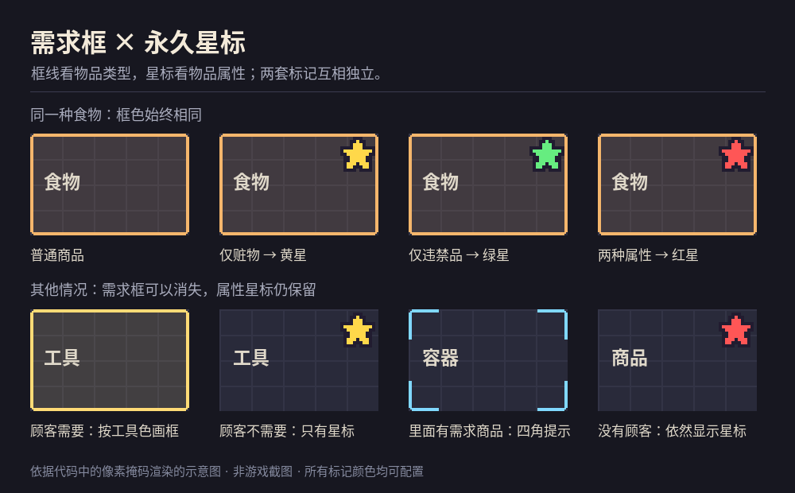

# Type Demand & Risk Stars

Customer-demand outlines and permanent risk stars for *Probably Stolen*.

[简体中文](README.md) · [Manual](doc/manual/index.md) · [Configuration](doc/manual/configuration.md) · [Building](doc/manual/building.md)

This is [Tangweirui2021's fork](https://github.com/Tangweirui2021/ProbablyStolen-DemandHighlight) of [Demand Highlight by KCN-judu](https://github.com/KCN-judu/ProbablyStolen-DemandHighlight), with a separate mod ID, `wrt_type_demand_stars`. Attribution and the Apache-2.0 license are in [NOTICE](NOTICE) and [LICENSE](LICENSE).

> Built with zero warnings against the supplied real game assemblies (internal label `VERSION 100-Rev13`). Patch-target checks and the game's own ModScanner passed. The installable test package is supplied separately; no game files are included in this repository. Gameplay/visual validation remains pending; see [VALIDATION.md](VALIDATION.md). The manifest temporarily retains upstream's Unity application-version declaration `0.46D`, a different field from the DLL's internal revision label.



## Behavior

| Marker | When shown | Default color |
| --- | --- | --- |
| Full demand outline | The customer accepts the item, or the manual filter matches it | Configurable per product type |
| Container corner brackets | The container itself does not match, but something inside does | One configurable pale blue |
| Top-right pixel star | The item itself is stolen only | Configurable yellow |
| Top-right pixel star | The item itself is contraband only | Configurable green |
| Top-right pixel star | The item itself has both statuses | Configurable red |

Legal status does not change the demand outline's color, pattern or fill intensity. Customer acceptance, variety and barter rules are retained. A container that is itself wanted receives its own type-colored full outline.

Stars run independently of the current customer, demand hotkey and shop inventory roots. Native item views created or validated on counters, customer goods, showcases, containers, machines and other scenes are registered. An ordinary container does not inherit its contents' risk star.

Outline thickness, rounding, faint fill, the Item Filter, statistics and key bindings remain available. Type priority, every marker color, star size and corner inset are configurable. Pixel stars use point-filtered masks and ignore pointer input. Native drag previews have their own star: a whole-stack pickup hides the old position, while a partial-stack drag marks both visible portions.

Stars default to about one third of a single grid cell. Large containers and one-cell items use the same size; existing saved size levels become compact automatically after updating.

The trashcan is part of the searchable stock: matching contents give the fixed bin a one-color corner hint; opening it marks each matching item.

An embedded scrolling checkbox dock sits below the trashcan, left of the main inventory. Choose types and stolen/contraband states to replace customer-demand highlights. Uncheck everything or use **Clear** to restore customer demand. **More** opens the advanced window; both controls share one filter expression.

## Settings

Enable the mod, then use **main menu → Mods → this mod's gear button**. Colors are hexadecimal text fields (`#RRGGBB` or `#RRGGBBAA`), applied with Apply. The native panel's availability from the shop pause menu has not been confirmed.

The game stores settings in `<Application.persistentDataPath>/ModConfigs/wrt_type_demand_stars.json`. Exit the game before editing it manually and retain the generated JSON structure. No separate YAML file is required.

A multi-type item uses the first type in `typePriority`; unlisted types have a stable fallback order. `CONTRABAND`, `STOLEN` and `RESTRICTED_*` never choose a frame color. See [all settings](doc/manual/configuration.md).

Both hotkeys are initially unbound. The demand/filter-outline hotkey does not disable stars; the permanent star layer has its own setting.

## Build and install

Use .NET SDK 8 or newer and the current game's `Probably Stolen_Data/Managed` assemblies.

```bash
GAME='/path/to/Probably Stolen' ./build.sh --install
```

```powershell
./build.ps1 -GamePath 'D:\SteamLibrary\steamapps\common\Probably Stolen' -Install
```

Output: `out/wrt_type_demand_stars/`. Copy that whole folder into the game's `Mods/` if installing manually. Disable the original Demand Highlight and overlapping marker mods, enable this fork and restart. See [Building](doc/manual/building.md).

## Validation and limitations

```bash
./tests/run.sh
python3 tools/check_docs.py
```

Thirteen pure-data suites and a stand-in integration suite exercise the fork. The real-assembly build and scanner checks were also completed separately; `tools/check-game.sh /path/to/Managed` repeats the API/scan checks. Actual Harmony execution and in-game Unity layout still require gameplay testing. See [VALIDATION.md](VALIDATION.md).

Entirely custom item interfaces that bypass native `GameItemElement` views need an adapter. Rotation, mirroring, irregular shapes and clipping still need real-game verification.

The inherited query API keeps its 1.x contract and names. Its whole-shop query scope differs from the stars' global item-view registry. [Manual](doc/manual/index.md) · [Changes](CHANGELOG.md) · [Report a problem](https://github.com/Tangweirui2021/ProbablyStolen-DemandHighlight/issues)
