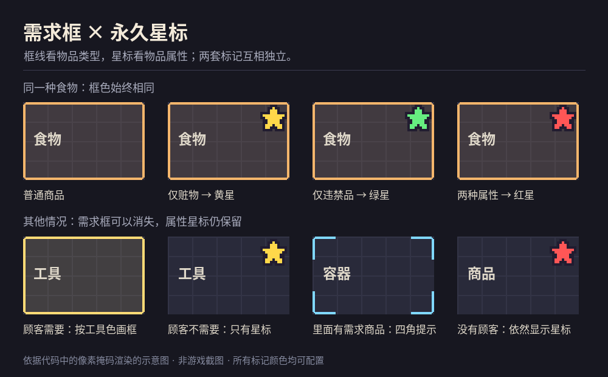

# Type Demand & Risk Stars

《深空当铺：可能是偷的》（Probably Stolen）的需求高亮与永久属性星标 Mod。

[English](README.en.md) · [中文手册](doc/zh-CN/index.md) · [配置](doc/zh-CN/configuration.md) · [构建与安装](doc/zh-CN/building.md)

基于 [KCN-judu 的 Demand Highlight](https://github.com/KCN-judu/ProbablyStolen-DemandHighlight) 修改，使用独立 Mod ID `wrt_type_demand_stars`。本仓库由 [Tangweirui2021](https://github.com/Tangweirui2021/ProbablyStolen-DemandHighlight) 维护；原作者署名与 Apache-2.0 许可证见 [NOTICE](NOTICE) 和 [LICENSE](LICENSE)。

> 当前提供源码。纯逻辑与替身集成测试已通过；仍需使用你的当前游戏程序集进行真实编译和游戏内验证。仓库不含游戏文件或可直接安装的发行 DLL。`manifest.xml` 中的 `0.46D` 沿用上游声明，不代表已经验证当前正式版兼容。



## 显示规则

| 标记 | 何时显示 | 默认颜色 |
| --- | --- | --- |
| 完整需求框 | 当前顾客需要该物品，或物品匹配手动筛选 | 按物品类型；可逐类配置 |
| 容器四角提示 | 容器本身不匹配，但里面有匹配物品 | 统一浅蓝色；可配置 |
| 右上角像素星 | 物品自身仅有赃物属性 | 黄色；可配置 |
| 右上角像素星 | 物品自身仅有违禁品属性 | 绿色；可配置 |
| 右上角像素星 | 物品自身同时为赃物与违禁品 | 红色；可配置 |

- 同类型商品的框色、线型和淡底色不因法律属性改变。需求框仍沿用顾客接受规则，包括多样化需求和以物易物。
- 星标独立于顾客与需求框开关：柜台、顾客出售的商品、展示柜、容器、机器及其他场景中被原生物品视图创建或刷新的物品，均进入独立判断。
- 星标只表达物品本体属性。普通容器不会继承内容物的星标；内容物的需求由四角提示表达。容器本体如果就是顾客需要的商品，会按自身类型画完整框。
- 保留框线粗细、圆角、淡底色、物品筛选和统计。新增多类型物品的颜色优先级、星标像素倍率和角落内边距设置。
- 星体采用像素掩码与点采样，不依赖字体，也不拦截鼠标点击。

## 配置

启用后进入 **主菜单 → Mods → 本模组的齿轮按钮**。颜色填写 `#RRGGBB` 或 `#RRGGBBAA`，按 Apply 应用；界面提供文字输入，并非图形取色器。经营画面的暂停菜单入口尚未确认。

游戏自动保存至 `<Application.persistentDataPath>/ModConfigs/wrt_type_demand_stars.json`。手动编辑时退出游戏，保留游戏生成的 JSON 结构。无需额外 YAML 文件。

多类型物品按 `typePriority` 的顺序选择一种类型色；未列出的类型采用稳定排序。`CONTRABAND`、`STOLEN`、`RESTRICTED_*` 不参与框色选择。全部配置键、默认值和范围见[配置手册](doc/zh-CN/configuration.md)。

需求框和物品筛选快捷键默认未绑定，需在游戏按键设置中自行绑定。关闭需求框不会关闭永久星标；星标有独立的设置开关。

## 构建与安装

需要 .NET SDK 8 或更新版本，以及当前游戏的 `Probably Stolen_Data/Managed` 文件夹。

Linux / Git Bash：

```bash
GAME='/path/to/Probably Stolen' ./build.sh --install
```

Windows PowerShell：

```powershell
./build.ps1 -GamePath 'D:\SteamLibrary\steamapps\common\Probably Stolen' -Install
```

构建输出为 `out/wrt_type_demand_stars/`。手动安装时将整个文件夹放入游戏 `Mods/`。停用原来的 Demand Highlight 和其他重叠高亮 Mod，启用本版并重启游戏。详细说明见[构建与安装](doc/zh-CN/building.md)。

## 测试和适用范围

```bash
./tests/run.sh
python3 tools/check_docs.py
```

测试需要 .NET SDK 8，覆盖 12 组纯逻辑测试及替身集成测试。最近的结果和未验证项见 [VALIDATION.md](VALIDATION.md)。替身测试不能代替当前游戏程序集编译、真实 Harmony 补丁或游戏内布局验证。

星标覆盖范围以原生 `GameItemElement` 视图的创建／刷新事件为基础。完全绕过该视图的附属 Mod 自建界面需另行适配。旋转、翻转、异形物品和窗口裁切仍需实机确认。

## 文档与开发

- [中文手册](doc/zh-CN/index.md) / [English manual](doc/manual/index.md)
- [筛选语言](doc/zh-CN/filter-language.md) / [Query API](doc/manual/query-api.md)
- [性能与生命周期](doc/zh-CN/performance.md)
- [更新记录](CHANGELOG.md)

查询 API 保留上游 1.x 契约和接口名称，方便现有客户端继续使用；API 的全店查询与永久星标的全界面注册是两种不同范围。代码和文档问题请提交到[本 Fork 的 Issues](https://github.com/Tangweirui2021/ProbablyStolen-DemandHighlight/issues)。
